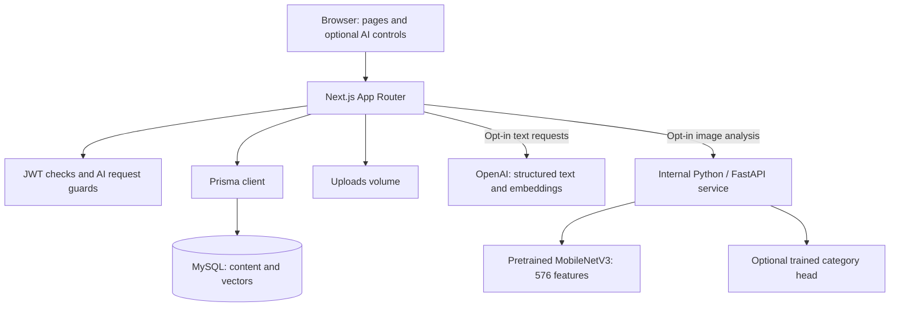
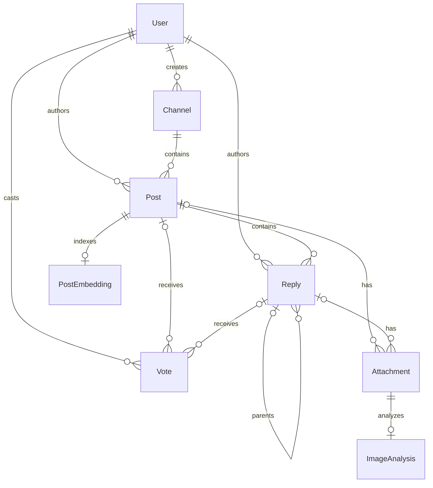

# Channel Q&A Tool

A full-stack programming discussion platform with topic channels, nested replies, screenshots, voting, and optional AI assistance. It helps users ask clearer questions, rediscover existing discussions, and catch up on long conversations.

**Next.js 16 · React 19 · TypeScript · Prisma · MySQL 8.4 · Docker · Python · PyTorch**

[Setup](#local-setup) · [Architecture](#architecture) · [Demo](#demo-walkthrough) · [AI configuration and evaluation](docs/AI_FEATURES.md) · [Testing](#testing)

## Features

| Capability | Implemented behavior |
| --- | --- |
| Channels and questions | Public browsing; authenticated channel/question creation |
| Conversations | Recursive nested replies, images on posts/replies, vote add/remove/reversal |
| Search | Text across questions/replies, author filtering, user activity and vote rankings; 10 results/page |
| Question review | Optional AI rewrite and missing-context checklist; user explicitly accepts suggestions |
| Similar questions | Text embeddings persisted in MySQL, content hashes, model-aware cosine retrieval |
| Thread summaries | Structured summaries with validated reply links and unresolved questions |
| CNN visual search | Local pretrained MobileNetV3 feature extraction and visually similar analyzed uploads |
| Screenshot categories | Optional category-head training/evaluation pipeline; no trained category checkpoint bundled |
| Demo data | Original fictional Q&A, repeatable seeds, synthetic screenshots, preserved existing passwords |
| Moderation | Role-gated admin dashboard and removal handlers; limitations below |

AI actions are optional. Regular posting, uploads, and existing search work without an API key or CNN service. No production deployment, real user adoption, or model accuracy is claimed.

## Architecture



One Next.js application serves pages and HTTP endpoints. Channel, discussion, and search pages fetch its API; the admin page reads Prisma directly. Text/image vectors remain in MySQL as JSON. Bounded linear retrieval suits this small demo; it is not a large-scale vector database.

### Request and API flow

Login compares a bcrypt hash and sets a seven-day JWT in an HTTP-only cookie. A reply handler verifies authentication, derives the author from the token, validates the post/parent relationship, writes through Prisma, then returns JSON or redirects the browser form. The discussion page reconstructs the tree from parentReplyId.

AI routes check that the user still exists, require a matching Origin, limit request size, and apply six requests per user per minute per app process. Summaries validate reply IDs before returning source links. Valid IDs establish link targets, not factual correctness.

| Endpoint | Purpose |
| --- | --- |
| POST /api/auth/{signup,login,logout} | Account/session actions |
| GET, POST /api/channels | List/create channels |
| GET /api/channels/:id | Channel and questions |
| POST /api/posts; GET /api/posts/:id | Create/read questions and discussion details |
| POST /api/replies; POST /api/votes | Reply creation and vote toggles |
| POST /api/uploads; GET /uploads/:filename | Store/retrieve images |
| GET /api/search | Existing text, author, user activity, and score search |
| POST /api/ai/question | Review draft or find related indexed questions |
| POST /api/ai/summary | Source-linked discussion summary |
| POST /api/ai/image | Analyze a saved attachment and find visual neighbors |
| POST /api/admin/{users,channels,posts,replies}/:id | Admin form deletion with _method=DELETE |

Most content writes support JSON and forms; forms generally redirect with 303. Uploads/admin operations use forms. AI endpoints use JSON and cookie authentication. [Detailed AI contracts](docs/AI_FEATURES.md).

## Database relationships



Email and channel names are unique. Composite constraints enforce one vote per user and target. Post/reply bodies use TEXT with application write limits. Embedding rows record model identity and content hashes; deleted posts cascade-delete their embeddings. Image bytes remain on disk. Optional post/reply foreign keys on votes and attachments rely on handlers to choose one target; the schema does not enforce exclusive-or targeting.

## Local setup

Prerequisites: Git, Docker with Compose, and free ports **3000** and **3307**.

```bash
git clone https://github.com/ayushvamja97/channel-qa-tool.git
cd channel-qa-tool
cp .env.example .env
# Replace every REPLACE value in .env before starting.
docker compose up --build
```

Use distinct random secrets; JWT_SECRET must contain at least 32 characters. A URL-safe MySQL password, such as a separately generated `openssl rand -hex 32` value, avoids connection-string escaping problems. Open **http://localhost:3000** after startup. The image builds Next.js and generates Prisma Client; startup waits for MySQL health, applies migrations, seeds basic accounts, and starts the app.

| Variable | Purpose |
| --- | --- |
| MYSQL_ROOT_PASSWORD | Compose MySQL password; used in its internal connection URL |
| DATABASE_URL | Host Prisma/development URL: mysql://root:<password>@localhost:3307/channel_qa_tool; Compose supplies db:3306 internally |
| JWT_SECRET | Required long signing secret; insecure fallback removed |
| SEED_ADMIN_PASSWORD, SEED_USER_PASSWORD | Initial passwords; subsequent seeds preserve existing passwords |
| SEED_DEMO_DATA | Explicit opt-in to the expanded fictional dataset |
| AI_ENABLED, OPENAI_API_KEY | Optional server-side text AI activation and key |
| OPENAI_TEXT_MODEL, OPENAI_EMBEDDING_MODEL | Model IDs; defaults in .env.example |
| VISION_SERVICE_URL, VISION_SERVICE_TOKEN | Internal CNN service and shared token |
| CLASSIFIER_PATH, CLASSIFIER_THRESHOLD | Optional trained category head and abstention threshold |

Compose sets NODE_ENV=production and PORT=3000. It declares UPLOAD_DIR, but current handlers always use `<project>/uploads`. Production cookies are Secure: verify localhost login persistence in your browser and use HTTPS on other hosts.

```bash
# Optional expanded demo data
docker compose exec -e SEED_DEMO_DATA=true app npm run seed:demo

# Optional AI overlay (configure .env first)
docker compose -f docker-compose.yml -f docker-compose.ai.yml up --build

# Explicit text indexing, after AI_ENABLED=true and OPENAI_API_KEY are configured
docker compose -f docker-compose.yml -f docker-compose.ai.yml exec app npm run ai:index

# Stop while keeping data
docker compose down
```

The basic plus expanded seeds produce **20 users, 10 channels, 62 questions, 181 replies, 600 votes, and six synthetic screenshot attachments** on a fresh database. The expanded seed uses stable keys and preserves existing discussions/passwords. Run one seed process at a time. Never seed a real community database. Provider calls do not run during seeding. **docker compose down -v deletes database and uploaded-image volumes.**

### Host development

With Node 20 and npm installed, configure the host DATABASE_URL in .env; leave NODE_ENV unset or use development.

```bash
docker compose up -d db
npm ci
npx prisma generate
# Wait for database readiness.
npx prisma migrate deploy
npm run seed
# Optional: set SEED_DEMO_DATA=true in .env first.
npm run seed:demo
npm run dev
```

Seeds load .env explicitly. Do not run the app container and host server on the same port. The [AI guide](docs/AI_FEATURES.md) covers host Python service startup, API requirements, and training.

## Demo walkthrough

1. Browse /channels signed out; topics include Python, JavaScript, TypeScript, React, Next.js, SQL, Docker, Java, AI/ML, and testing.
2. Sign in as user@example.com using your initial SEED_USER_PASSWORD. Draft a question, request a review, and explicitly accept or discard the suggestion.
3. After indexing, try related-question discovery with a paraphrase such as Python nested rows changing together.
4. Publish a question, add a reply and nested reply, and demonstrate vote add/remove/reversal. These work independently of AI.
5. Summarize a seeded discussion and follow its reply source links.
6. With vision running, analyze the synthetic images in the first seeded Python and JavaScript questions, then retry the first to explore visual neighbors.
7. Sign in as admin@example.com with your initial SEED_ADMIN_PASSWORD, visit /admin, and moderate disposable content. Remove replies before posts, then empty channels.

Additional fictional accounts are demo1@example.com through demo18@example.com, initially using SEED_USER_PASSWORD. Existing passwords are preserved; no public hosted-demo credentials are included.

### Screenshots

**Actual application captures pending.** Images in prisma/demo-images are visibly labeled synthetic fixtures, not application screenshots or a classifier training dataset.

| Capture placeholder | Show |
| --- | --- |
| docs/screenshots/question-assistant.png | Question review and related discussions |
| docs/screenshots/discussion-summary.png | Nested replies, votes, source-linked summary |
| docs/screenshots/cnn-image-search.png | Analyzed upload and visual-neighbor links |
| docs/screenshots/admin.png | Moderation with fictional data |

Add real captures after reviewing the running app; hide personal information and secrets.

## Testing

```bash
npm test
npm run lint
npx tsc --noEmit
npm run build
```

For database integration, point DATABASE_URL at a **fresh disposable database ending in _test**, set ALLOW_TEST_DATABASE=true, then run `npm run test:integration`. It applies migrations and writes fixtures/test data. Python tests and an opt-in real-provider retrieval evaluation are described in the [AI guide](docs/AI_FEATURES.md). CI configuration targets MySQL 8.4 and CPU CNN tests; verify a remote run before claiming passing CI.

Local validation passed: production build, TypeScript, schema validation, seven Node boundary tests, and five real pretrained-CNN service tests. Integration passed against MariaDB 10.11: migrations, exact seed counts, repeat seeding/password preservation, content writes, reply-parent checks, vote toggles, retrieval and summaries with a mocked text provider, plus real CNN HTTP inference through the app route with persisted vectors. Docker Compose/MySQL 8.4 startup and paid text-provider output quality remain separate checks.

## Limitations and next work

- Channel deletion is blocked while posts exist; post deletion is blocked while replies exist. User deletion has a separate cleanup transaction. Deleting attachment metadata does not remove disk files.
- Some server pages hardcode localhost:3000. The discussion's internal read does not forward the browser cookie, so personalized vote information is not displayed from that fetch. Public deployment routing needs review.
- Similarity retrieval uses bounded linear scans with a 5,000-vector guard. New questions require rerunning ai:index. No background queue, distributed rate limiter, or relevance guarantee is included.
- The CNN uses pretrained ImageNet features. Visual similarity can emphasize color/layout. Screenshot classification needs your labeled dataset and trained/evaluated head; no category accuracy is claimed.
- AI text can be wrong. Source-ID checks do not verify claim support. No generated text is automatically posted or used for deletion.
- Uploads are public, any signed-in user can attach to an existing discussion, and regular upload validation trusts declared MIME type. The CNN service independently decodes images. Filesystem/database writes are not atomic.
- JWT roles are token claims with no server-side revocation; form feedback is basic; user-activity search exposes email addresses. Hardening remains before public use.

## What I built and learned

The implementation connects server-rendered UI, HTTP handlers, accounts, relational persistence, recursive replies, vote constraints, container orchestration, structured AI outputs, semantic retrieval, and a separate CNN feature service.

**Author reflection draft — confirm before using:** “I learned how to connect a full-stack application to optional AI services while keeping its core workflow independent of model availability. I implemented persistent text/image embeddings, validated structured responses and source IDs, and added repeatable demo data and integration tests. I also learned why pretrained CNN features differ from a task-specific classifier and why quality needs a held-out evaluation.”

Confirm individual contributions, collaborators, course context, and assistance/tool attribution before using first-person wording. The CNN feature uses pretrained weights; no trained screenshot-category checkpoint is bundled.

## Project map

| Path | Responsibility |
| --- | --- |
| src/app/(routes), src/components | Pages and interactive controls |
| src/app/api, src/lib/ai | HTTP handlers, provider boundary, retrieval, guards, vision client |
| prisma | Schema, migrations, basic/expanded seeds, original Q&A, synthetic fixtures |
| scripts | Indexing and small retrieval evaluation |
| vision | FastAPI/PyTorch feature service, category-head training, tests |
| tests, .github/workflows | Boundary tests, database integration, CI configuration |
| docker-compose*.yml | Base app/database and optional AI overlay |

Before sharing: approve the reflection/attribution, add actual screenshots, verify any hosted demo URL/access policy, and choose a license before making a reuse claim. No license file is currently tracked.

